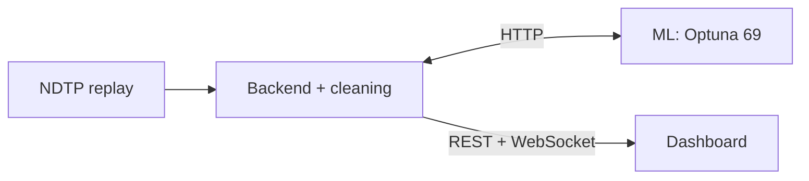

# Predictor Dispatch — итоговое решение хакатона

Прогноз задержек транспорта на горизонте **10–15 минут**: NDTP-поток,
причинная очистка, ML-инференс и диспетчерский дашборд.
Итоговая модель — **Optuna CatBoost, 69 признаков**; дашборд и CSV используют одни веса.

## Ссылки для жюри

- **[Рабочая система](https://dispatch.111.88.241.89.sslip.io/)**
- **[Инструкция, сценарий проверки и производительность](https://dispatch.111.88.241.89.sslip.io/reference/)**
- **[Swagger](https://dispatch.111.88.241.89.sslip.io/docs)** · **[PyDoc](https://dispatch.111.88.241.89.sslip.io/reference/code/)**
- **[CSV для Data Science](submission/submission.csv)** · [происхождение](submission/README.md)

## Три блока

| Модуль | Назначение |
|---|---|
| **[ml/](ml/README.md)** | Признаки, текущие веса, HTTP-инференс и воспроизведение CSV |
| **[backend/](backend/README.md)** | NDTP, оркестрация, расписание, REST и WebSocket |
| **[dashboard/](dashboard/README.md)** | Карта, риск, карточки и what-if |



Дополнительно: `cleaning/` — очистка, `data/` — входной контракт и хеши,
`deploy/` — облачное развёртывание и страницы жюри, `docs/` — архитектура/API,
`scripts/` — команды запуска и воспроизведения, `tests/` — проверки итоговой системы.

## Запуск из Docker

Нужны Docker Compose и [данные организаторов](https://disk.yandex.ru/d/CA6tsj4aJJ4Aaw).
Скачайте или клонируйте этот репозиторий. Разместите четыре файла по [data/README.md](data/README.md), затем:

```bash
cp .env.example .env
# При необходимости укажите DATA_ROOT в .env.
docker compose up --build -d
```

Дашборд: http://localhost:8080 · Swagger: http://localhost:8000/docs.
Остановка: `docker compose down`. Для карты улиц нужен интернет.
Веса уже включены; обучение не требуется. Отдельный ML: `docker compose up --build -d ml`.

## Проверки и воспроизведение

```bash
python3 -m venv .venv
.venv/bin/pip install -r tests/requirements.txt
.venv/bin/python -m pytest -q
docker compose config --quiet
.venv/bin/python scripts/smoke_dispatch.py  # при запущенном локальном стеке
.venv/bin/python scripts/generate_submission.py --output outputs/submission_reproduced.csv
```

Полный pytest требует локальной раздачи; для повторного CSV нужны разрешённые
validate-входы и sample_submission, перечисленные в [инструкции](submission/README.md).
Выходной CSV должен быть новым. Данные и веса не изменяются.

## Границы решения

Демо воспроизводит исторический поток с виртуальным временем. Прогноз — задержка
в секундах, не калиброванная вероятность. `plan-<tr_id>` обозначает план одного ТС,
а не зарегистрированный маршрут. Причина сбоя, двери и индивидуальная погрешность
могут быть неизвестны. Метрики replay не являются независимой online-валидацией.
[Соответствие заданию](docs/HACKATHON.md) · [Архитектура](docs/LIVE_SYSTEM.md).

## Публичная версия для жюри

Этот репозиторий содержит финальный код, веса модели, submission и инструкции.
Датасет организаторов подключается отдельно по инструкции выше. История разработки,
архивные модели и локальные настройки в эту копию не включены.
